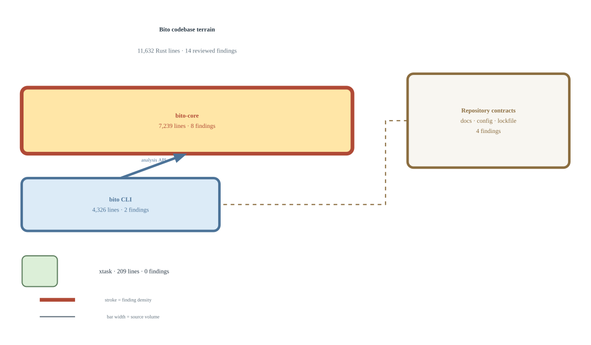

# Audit: bito

Bito has a disciplined Rust baseline: Clippy, RustSec, and cargo-deny are
clean, its own code is free of `unsafe`, and no concrete concurrency hazard
was found. **The Output Contract Surface** can report success when configured
quality gates fail and can reorder tied results between processes. **The
Documented Capability Surface** contains three code/documentation mismatches,
while **The Analysis Runtime Surface** has one user-reachable UTF-8 panic and
several contained design costs. **The Dependency Hygiene Surface** is healthy
apart from two avoidable declarations. Fourteen findings survived independent
review—twelve confirmed and two corrected—with no disputes; restoring the
public contract is the main job.

<p align="center">

</p>

<sub>
Module size is proportional to code volume. Stroke weight indicates finding
density. Generated from recon.yaml.
</sub>

---

## The Output Contract Surface

*Bito computes rich reports, but suppression, gating, ordering, and protocol
translation can turn the same input into a misleading success or an unstable
result.*

### Analyze thresholds not enforced

**significant** · `crates/bito/src/commands/analyze.rs:217-239` · effort: small · 

The analysis core records readability and passive-voice threshold failures,
but the CLI's only post-analysis gate checks `style_min`. Config-driven linting
has the same omission. `--max-grade`, `--passive-max`, and their configured
equivalents can therefore report failed thresholds while `bito analyze` and
`bito lint` exit successfully—the opposite of the documented quality-gate
contract.

```rust crates/bito/src/commands/analyze.rs:217-239
    style_gate(&args.file, style_min, &report)
}

/// Apply the minimum style-score threshold.
///
/// Both output paths call this. The JSON branch used to return early and skip
/// it entirely, so `--json` reported a failing score and still exited 0.
fn style_gate(
    file: &Utf8PathBuf,
    style_min: Option<i32>,
    report: &analysis::FullAnalysisReport,
) -> anyhow::Result<()> {
    if let (Some(min), Some(st)) = (style_min, &report.style)
        && st.style_score < min
    {
        return Err(IssuesFound(format!(
            "{file} style score {} is below minimum {min} — improve writing quality.",
            st.style_score,
        ))
        .into());
    }

    Ok(())
}
```

> A CI gate that prints “failed” and exits zero is a comment, not a gate. I do
> not need to bypass it; I only need the pipeline to trust the exit status.

Related to [default-analyze-suppressions-ignored](#default-analyze-suppressions-ignored).

**Remediation:** Replace `style_gate` with a shared verdict helper that checks
every enabled threshold, and use it for both direct analysis and
`LintReport::pass`. Cover text, JSON, ad-hoc, and rule-driven paths with focused
regressions.

<div>&hairsp;</div>

### Default analyze suppressions ignored

**moderate** · `crates/bito-core/src/lint.rs:61-72` · effort: small · 

An analyze rule with neither `checks` nor `exclude` uses `None` to mean all 18
checks. Suppression filtering only runs when that value is `Some`, so the
documented unclosed `disable style` directive cannot suppress `style` in the
default-all case. The common configuration path can still report—and once the
gate is repaired, fail—checks the file explicitly disabled.

```rust crates/bito-core/src/lint.rs:61-72
    // --- analyze ---
    let analyze_report = if let Some(ref ac) = resolved.analyze {
        // Filter out fully-suppressed sub-checks from the analyze check list.
        let mut check_list = resolve_analyze_checks(ac)?;
        if !suppressions.is_empty()
            && let Some(ref mut checks) = check_list
        {
            checks.retain(|c| !suppressions.is_fully_suppressed(c));
        }
        // If all requested checks were suppressed, skip analyze entirely.
        if check_list.as_ref().is_some_and(|c| c.is_empty()) {
            None
```

Related to [analyze-thresholds-not-enforced](#analyze-thresholds-not-enforced).

**Remediation:** Materialize `ALL_CHECKS` before pruning fully suppressed
checks, then treat an empty list as a skipped aggregate analysis. Add a default
`AnalyzeRuleConfig` regression with an unclosed aggregate-check directive.

<div>&hairsp;</div>

### Full analysis errors silently discarded

**moderate** · `crates/bito-core/src/analysis/mod.rs:114-124` · effort: small · 

Readability and grammar return `AnalysisError::EmptyInput` when input has no
scorable words or sentences. Calling `.ok()` erases those errors and makes a
failed enabled check indistinguishable from a disabled one. Punctuation-only
input passes the initial whitespace guard and can produce a nominally
successful report with both sections absent.

```rust crates/bito-core/src/analysis/mod.rs:114-124
    // Readability
    let readability_report = if enabled.contains("readability") {
        readability::check_readability(&prose, false, max_grade).ok()
    } else {
        None
    };

    // Grammar
    let grammar_report = if enabled.contains("grammar") {
        grammar::check_grammar_full(&prose, false, passive_max).ok()
    } else {
```

Related to [mcp-input-errors-reported-as-internal](#mcp-input-errors-reported-as-internal).

**Remediation:** Propagate enabled-check failures with `?`. If partial reports
are intentional, model check failure separately from disabled state and retain
the typed error in the public result.

<div>&hairsp;</div>

### Randomized ties break determinism

**significant** · `crates/bito-core/src/analysis/acronyms.rs:17-31` · effort: medium · 

Several analyzers collect report arrays from randomly seeded `HashMap`s and
sort only by frequency. Equal-frequency entries retain process-specific map
order. Identical input can therefore produce different acronym, word, phrase,
diction, jargon, transition, and style-detail ordering across invocations,
violating Bito's explicit same-input/same-result promise.

```rust crates/bito-core/src/analysis/acronyms.rs:17-31
pub fn analyze_acronyms(text: &str) -> AcronymReport {
    let mut counts: HashMap<String, usize> = HashMap::new();

    for m in ACRONYM_RE.find_iter(text) {
        *counts.entry(m.as_str().to_string()).or_insert(0) += 1;
    }

    let total_acronyms: usize = counts.values().sum();
    let unique_acronyms = counts.len();

    let mut acronym_list: Vec<AcronymCount> = counts
        .into_iter()
        .map(|(acronym, count)| AcronymCount { acronym, count })
        .collect();
    acronym_list.sort_by_key(|x| Reverse(x.count));
```

**Remediation:** Give every externally visible collection a total order:
frequency descending, then term or phrase ascending. Add repeated-process
fixtures with tied counts across every `HashMap`-derived report.

<div>&hairsp;</div>

### MCP input errors reported as internal

**moderate** · `crates/bito/src/server.rs:319-331` · effort: small · 

`run_full_analysis` has caller-correctable variants for empty input and unknown
checks, but the MCP boundary maps every analysis error to JSON-RPC internal
error `-32603`. Size and dialect validation correctly use invalid params
`-32602`. Clients cannot reliably distinguish requests they should fix from
server faults they may retry, and the same blanket conversion appears across
the analysis tools.

```rust crates/bito/src/server.rs:319-331
        self.validate_input(&params.text)?;

        let dialect = parse_dialect(params.dialect.as_deref())?;
        let checks_ref = params.checks.as_deref();
        let report = analysis::run_full_analysis(
            &params.text,
            params.strip_markdown,
            checks_ref,
            params.max_grade,
            params.passive_max,
            dialect,
        )
        .map_err(|e| McpError::internal_error(e.to_string(), None))?;
```

Related to [full-analysis-errors-silently-discarded](#full-analysis-errors-silently-discarded).

**Remediation:** Centralize `AnalysisError` to `McpError` conversion. Map
caller-correctable variants to invalid params and reserve internal error for
faults outside the request contract.

*Verdict: The pipeline has the data required to behave correctly. A shared
verdict, deterministic tie-breakers, explicit disabled/error states, and one
protocol conversion layer would remove the ambiguity without redesigning the
analyzers.*

---

## The Documented Capability Surface

*Three shipped interfaces advertise concrete behavior that the current
implementation either removed, changed, or never wired.*

### Documented ConfigLoader is unreachable

**significant** · `README.md:349-358` · effort: medium · 

The librebar migration removed `bito_core::config::ConfigLoader` and replaced
it with `config::load(cwd, explicit)`. The authoritative README still presents
the removed builder as the library API. A consumer following the example fails
at import resolution before configuration discovery begins.

````markdown README.md:349-358
The `ConfigLoader` provides flexible configuration discovery:

```rust
use bito_core::config::ConfigLoader;

let config = ConfigLoader::new()
    .with_project_search(std::env::current_dir()?)
    .with_user_config(true)
    .load()?;
```
````

**Remediation:** Restore a compatibility `ConfigLoader` facade that delegates
to librebar while retaining `load` as the simple entry point. If the facade is
transitional, publish and test a deprecation path rather than silently removing
the documented API.

<div>&hairsp;</div>

### OpenAI backend uses wrong tokenizer

**significant** · `docs/tokens.md:135-140` · effort: medium · 

The token guide defines `openai` as exact cl100k_base counting. The code maps
that backend through `ah-ah-ah` to o200k_base. Those vocabularies produce
different counts, so budgets selected for GPT-4-era cl100k_base models are not
the exact budgets Bito claims to enforce.

```markdown docs/tokens.md:135-140
## OpenAI Backend

The `openai` backend uses `bpe-openai` for exact cl100k_base BPE encoding.
No estimation, no greedy heuristics — this is the real tokenizer.

Use it when you need exact GPT-4 / cl100k_base counts.
```

**Remediation:** Make `openai` select cl100k_base. If o200k_base remains,
expose it under a distinct backend name and retain `openai` as a compatibility
alias through a documented migration.

<div>&hairsp;</div>

### Otel endpoint config is ignored

**moderate** · `config/bito.toml.example:37-39` · effort: medium · 

Both shipped configuration templates advertise `otel_endpoint`, but `Config`
has no such field and the CLI enables no corresponding librebar telemetry
capability. Unknown fields are accepted, so the option parses without error
while configuring no exporter and sending no telemetry.

```toml config/bito.toml.example:37-39
# Config options:
# - log_dir = "/path/to/log/dir"
# - otel_endpoint = "http://127.0.0.1:4317"
```

**Remediation:** Add a typed endpoint, enable and initialize the matching
telemetry capability, validate malformed endpoints, and add a
configuration-to-exporter smoke test. If OpenTelemetry is not supported,
remove the option from both templates instead.

*Verdict: These are public-contract failures, not feature requests. Restore
compatibility or publish explicit migrations; accepting configuration and
examples that do nothing is especially damaging in a quality-gate tool.*

---

## The Analysis Runtime Surface

*The core analyzers are memory-safe, but one byte-index operation can panic and
repeated ownership choices amplify allocation work on large documents.*

### Sticky sentence UTF8 truncation panic

**significant** · `crates/bito-core/src/analysis/sticky.rs:60-65` · effort: trivial · 

The sticky-sentence analyzer passes user-controlled text to `truncate` with a
100-byte maximum. Rust string slicing uses byte offsets. A sentence longer than
100 bytes whose multibyte character crosses offset 100 panics in the default
CLI, lint, and MCP analysis paths.

```rust crates/bito-core/src/analysis/sticky.rs:60-65
fn truncate(s: &str, max: usize) -> String {
    if s.len() <= max {
        s.to_string()
    } else {
        format!("{}...", &s[..max])
    }
```

> I do not need malformed UTF-8—Rust already rejects that. I only need valid
> prose with a multibyte character at the unlucky byte boundary, and the
> analysis request becomes a process-level panic.

**Remediation:** Find the boundary with `char_indices` or a manual
`is_char_boundary` loop before slicing. Add a regression with a multibyte
character spanning byte 100. `floor_char_boundary` is not available at the
project's Rust 1.89 MSRV.

<div>&hairsp;</div>

### Analysis reallocates word vectors per sentence

**advisory** · `crates/bito-core/src/analysis/sticky.rs:28-37` · effort: medium · 

`extract_words` returns `Vec<String>` and lowercases every token. Sticky,
pacing, sentence-length, complex-paragraph, and echoes analysis each tokenize
overlapping sentence or paragraph content independently. At the supported
multi-megabyte input size, default analysis repeats allocation work
proportional to word count even when a consumer only needs a count.

```rust crates/bito-core/src/analysis/sticky.rs:28-37
    for (idx, sentence) in sentences.iter().enumerate() {
        let s_words = text::extract_words(sentence);
        if s_words.is_empty() {
            continue;
        }
        let glue = s_words
            .iter()
            .filter(|w| GLUE_WORDS.contains(w.as_str()))
            .count();
        let pct = (glue as f64 / s_words.len() as f64) * 100.0;
```

Related to [matched-words-cloned-before-map-lookup](#matched-words-cloned-before-map-lookup).

**Remediation:** Tokenize once in orchestration and pass shared slices to
private helpers. Preserve the existing public analyzer entry points as
compatibility wrappers. Use allocation-free iteration for count-only consumers
and own tokens only where reports require it.

<div>&hairsp;</div>

### Matched words cloned before map lookup

**advisory** · `crates/bito-core/src/analysis/diction.rs:15-19` · effort: trivial · 

`HashMap::entry` consumes its key, so `w.clone()` allocates before the lookup
can discover an existing entry. Repeated vague and jargon terms allocate and
discard duplicate strings on every occurrence even though the input word
vector outlives both analyses.

```rust crates/bito-core/src/analysis/diction.rs:15-19
    // Check single words
    for w in words {
        if VAGUE_WORDS.contains(w.as_str()) {
            *counts.entry(w.clone()).or_insert(0) += 1;
        }
```

Related to [analysis-reallocates-word-vectors-per-sentence](#analysis-reallocates-word-vectors-per-sentence).

**Remediation:** Count with `HashMap<&str, usize>` and allocate owned strings
only while constructing the final report. Apply the same change to diction and
jargon analysis.

<div>&hairsp;</div>

### Analysis thresholds share primitive type

**moderate** · `crates/bito-core/src/analysis/mod.rs:60-78` · effort: medium · 

The public `run_full_analysis` function accepts adjacent `Option<f64>` values
for a grade level and a percentage. Swapping them compiles and applies
plausible numbers to the wrong checks. Positional forwarding from the CLI, MCP,
or downstream callers gets no help from the type system.

```rust crates/bito-core/src/analysis/mod.rs:60-78
/// Run full writing analysis.
///
/// # Arguments
///
/// * `input` — The text to analyze.
/// * `strip_md` — If `true`, strip markdown formatting before analysis.
/// * `checks` — Optional list of check names to run. If `None`, runs all.
/// * `max_grade` — Optional max readability grade.
/// * `passive_max` — Optional max passive voice percentage.
/// * `dialect` — Optional dialect for spelling enforcement.
#[tracing::instrument(skip(input), fields(text_len = input.len(), strip_md))]
pub fn run_full_analysis(
    input: &str,
    strip_md: bool,
    checks: Option<&[String]>,
    max_grade: Option<f64>,
    passive_max: Option<f64>,
    dialect: Option<Dialect>,
) -> AnalysisResult<FullAnalysisReport> {
```

Related to [analyze-thresholds-not-enforced](#analyze-thresholds-not-enforced).

**Remediation:** Introduce validated grade and percentage newtypes inside a
named `AnalysisOptions` value. Keep the current function as a deprecated
compatibility wrapper and migrate call sites without renaming the public API
out from under consumers.

*Verdict: Repair the UTF-8 boundary first. The remaining work is a focused
internal optimization and type-safety pass that can preserve every public
entry point and requires no new dependency.*

---

## The Dependency Hygiene Surface

*The dependency tree has no known advisories or policy failures, but two direct
declarations add avoidable maintenance weight.*

### Unused anyhow in bito core

**advisory** · `crates/bito-core/Cargo.toml:35` · effort: trivial · 

Both Bito-scoped `cargo udeps` and `cargo machete` identify `anyhow` as unused
by bito-core, and the crate contains no `anyhow` references. The declaration
adds a direct maintenance edge without providing behavior.

```toml crates/bito-core/Cargo.toml:35
anyhow = "1.0"
```

**Remediation:** Remove the bito-core declaration. The CLI crate's separate,
used `anyhow` dependency is unaffected.

<div>&hairsp;</div>

### Deprecated serde yaml dev dependency

**advisory** · `Cargo.lock:1773-1776` · effort: small · 

bito-core directly uses `serde_yaml` in four configuration tests. The lockfile
resolves it to the explicitly deprecated `0.9.34+deprecated`, while the
workspace already contains serde-saphyr through librebar. This is test-only,
but it preserves an unnecessary parser and maintenance path.

```toml Cargo.lock:1773-1776
[[package]]
name = "serde_yaml"
version = "0.9.34+deprecated"
source = "registry+https://github.com/rust-lang/crates.io-index"
```

**Remediation:** Replace the test dependency and its four `from_str` calls with
serde-saphyr's compatible API, then regenerate the lockfile through the
project's dependency workflow.

*Verdict: RustSec, licenses, sources, and bans are clean. Removing one unused
runtime dependency and replacing one deprecated test parser makes the declared
surface match that strong posture.*

---

## Remediation Ledger

| Finding | Concern | Location | Effort | Chains |
|---------|---------|----------|--------|--------|
| | | **Output Contract Surface** | | |
| [analyze-thresholds-not-enforced](#analyze-thresholds-not-enforced) | significant | `crates/bito/src/commands/analyze.rs:217-239` | small | related: default-analyze-suppressions-ignored |
| [default-analyze-suppressions-ignored](#default-analyze-suppressions-ignored) | moderate | `crates/bito-core/src/lint.rs:61-72` | small | related: analyze-thresholds-not-enforced |
| [full-analysis-errors-silently-discarded](#full-analysis-errors-silently-discarded) | moderate | `crates/bito-core/src/analysis/mod.rs:114-124` | small | related: mcp-input-errors-reported-as-internal |
| [randomized-ties-break-determinism](#randomized-ties-break-determinism) | significant | `crates/bito-core/src/analysis/acronyms.rs:17-31` | medium | — |
| [mcp-input-errors-reported-as-internal](#mcp-input-errors-reported-as-internal) | moderate | `crates/bito/src/server.rs:319-331` | small | related: full-analysis-errors-silently-discarded |
| | | **Documented Capability Surface** | | |
| [documented-config-loader-is-unreachable](#documented-config-loader-is-unreachable) | significant | `README.md:349-358` | medium | — |
| [openai-backend-uses-wrong-tokenizer](#openai-backend-uses-wrong-tokenizer) | significant | `docs/tokens.md:135-140` | medium | — |
| [otel-endpoint-config-is-ignored](#otel-endpoint-config-is-ignored) | moderate | `config/bito.toml.example:37-39` | medium | — |
| | | **Analysis Runtime Surface** | | |
| [sticky-sentence-utf8-truncation-panic](#sticky-sentence-utf8-truncation-panic) | significant | `crates/bito-core/src/analysis/sticky.rs:60-65` | trivial | — |
| [analysis-reallocates-word-vectors-per-sentence](#analysis-reallocates-word-vectors-per-sentence) | advisory | `crates/bito-core/src/analysis/sticky.rs:28-37` | medium | related: matched-words-cloned-before-map-lookup |
| [matched-words-cloned-before-map-lookup](#matched-words-cloned-before-map-lookup) | advisory | `crates/bito-core/src/analysis/diction.rs:15-19` | trivial | related: analysis-reallocates-word-vectors-per-sentence |
| [analysis-thresholds-share-primitive-type](#analysis-thresholds-share-primitive-type) | moderate | `crates/bito-core/src/analysis/mod.rs:60-78` | medium | related: analyze-thresholds-not-enforced |
| | | **Dependency Hygiene Surface** | | |
| [unused-anyhow-in-bito-core](#unused-anyhow-in-bito-core) | advisory | `crates/bito-core/Cargo.toml:35` | trivial | — |
| [deprecated-serde-yaml-dev-dependency](#deprecated-serde-yaml-dev-dependency) | advisory | `Cargo.lock:1773-1776` | small | — |

<sub>
Generated 2026-08-06 at commit 13e9127. Intermediate artifacts: recon.yaml,
findings.yaml. Independent evidence review: review.yaml.
</sub>
